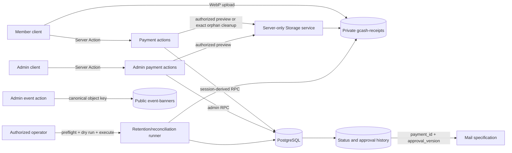

# Payment Security Lifecycle Design

## Table of Contents

- [Overview](#overview)
- [Goals and Non-Goals](#goals-and-non-goals)
- [Decisions and Unresolved Gates](#decisions-and-unresolved-gates)
- [Architecture](#architecture)
- [Data Model](#data-model)
- [Lifecycle Operations](#lifecycle-operations)
- [Receipt Storage and Preview](#receipt-storage-and-preview)
- [Retention and Holds](#retention-and-holds)
- [Event-Banner Object-Key Migration](#event-banner-object-key-migration)
- [Authorization Model](#authorization-model)
- [Migration and Deployment Strategy](#migration-and-deployment-strategy)
- [Error Handling and Observability](#error-handling-and-observability)
- [Correctness Properties](#correctness-properties)
- [Verification Strategy](#verification-strategy)
- [Traceability](#traceability)
- [Risks and Mitigations](#risks-and-mitigations)

## Overview

This design moves payment integrity from cooperative application validation to explicit PostgreSQL, Row-Level Security (RLS), Storage, and privileged-operation boundaries. Members upload a narrowly constrained private WebP object and call one payment-submission operation. Admins review and reopen payments only through dedicated lifecycle operations. Direct table writes cannot forge owners, status, review fields, timestamps, academic-year identity, approval versions, or history.

The design is additive first. Existing data is profiled, mapped, remediated, or placed in a restricted migration quarantine before strict constraints are enabled. Irreversible history is never removed to make a rollback appear successful. Application rollback is supported only while compatibility columns and routines remain available; defects after irreversible migration use forward fixes.

The design also replaces event-banner absolute URLs with bucket-relative object keys. This work is included here because current event writes persist absolute Supabase URLs and the security release gate requires trusted key storage.

## Goals and Non-Goals

### Goals

1. Enforce payment amount, reference, receipt, ownership, initial-state, and uniqueness rules under concurrent direct API use.
2. Provide an explicit status graph with admin-only review and reasoned reopening.
3. Preserve append-only status, approval, hold, and receipt-deletion evidence.
4. Store an explicit academic-year identity on every operational payment without guessing the current academic year.
5. Keep receipts private while allowing associated-object previews through 60-second bearer URLs.
6. Remove only verified orphan receipts through narrow, fixed-bucket operations.
7. Model provisional retention defaults and prevent production deletion until required ratification and operator assignment exist.
8. Replace event-banner absolute URLs with canonical object keys through a verified, retry-safe migration.
9. Provide direct boundary tests, redacted evidence, and rehearsed migration gates.

### Non-Goals

- This specification does not choose the current academic-year label, start date, or end date.
- This specification does not ratify retention policy or name an early-deletion/annual-cleanup operator.
- This specification does not implement a general service-role Storage deletion endpoint.
- This specification does not make signed receipt URLs identity-bound after issuance; they are bearer URLs until expiry.
- This specification does not define approval-email rendering, routing, retries, or exports. It exposes the immutable approval-version contract consumed by `server-actions-email-exports`.
- This specification does not build native ticketing or change the external Luma handoff.

## Decisions and Unresolved Gates

| Topic | Design decision | Gate |
| --- | --- | --- |
| Amount | PHP `1.00` through `100000.00`, inclusive; submitted representation has at most two decimal places | Fixed |
| Reference | Exactly 13 ASCII digits; globally unique | Fixed |
| Initial state | Member submission creates `pending`; all server-owned review/version/time fields are canonicalized | Fixed |
| Review graph | `pending -> approved`, `pending -> rejected`, `approved -> pending`, and `rejected -> pending` only | Fixed |
| Reopen | Admin-only dedicated operation; trimmed reason is 10–500 characters | Fixed |
| Approval identity | Monotonic per-payment approval version and immutable approval row | Fixed |
| Academic year | Explicit stable ID is stored; configuration holds label/start/end | Model fixed; current values unresolved |
| Metadata retention | 60 months from payment creation | Provisional; production disposition disabled |
| Receipt retention | Through 24 months after the explicit academic-year end | Provisional; production deletion disabled |
| Holds | Active dispute or audit hold blocks receipt, early, and metadata disposition | Fixed |
| Preview | Owner/admin authorization; signed URL TTL exactly 60 seconds | Fixed |
| Banner limit | WebP smaller than 524288 bytes; canonical `<event-id>/<object-uuid>.webp` key | Fixed technical ceiling |
| Retention operator | Separately authorized operator, not every admin implicitly | Unresolved assignment |

No task may populate an academic year from `created_at`, a school-calendar convention, a display string, or an inferred current date. Until one approved active academic year exists, new payment submission fails with a configuration-unavailable result.

## Architecture

### Components



### Trust boundaries

- The browser may compress and upload, but it is not authoritative for amount, object metadata, owner, status, role, timestamps, academic year, or recipient.
- Server Actions call `getCurrentUser()` before protected work and return the shared `ActionResponse<T>` contract.
- PostgreSQL routines derive `auth.uid()` and recheck role/row version. They do not accept owner, reviewer, approval version, timestamps, or mail recipient as authoritative parameters.
- RLS remains enabled on `profiles`, `events`, `payments`, and every new lifecycle table. Application roles receive no direct payment `UPDATE` or `DELETE` privilege.
- A dedicated no-login lifecycle function owner receives only the table/sequence privileges required by reviewed routines. Every security-definer routine has a fixed `search_path`, explicit execution grants, and revoked `PUBLIC` execution.
- Service-role Storage access exists only in server-only helpers and operator scripts with fixed bucket names and constrained selectors.

### Shared-file ownership and merge checkpoints

| Shared surface | Sole owner | Consumer rule |
| --- | --- | --- |
| Payment schema, projection guards, approval/version/history core routines | PSL | SAE consumes `PSL-APPROVAL-CORE-v1`; it changes only the documented delivery extension point |
| Receipt preview, cleanup, retention, and banner semantics | PSL | SAE may consume safe projections; it does not edit these actions or policies |
| Canonical `ActionResponse`, error categories, correlation IDs, and redacted diagnostics | SAE | PSL adapters import/consume; PSL does not define a competing shared type or logger |
| Delivery schema and approval-routine delivery extension | SAE | PSL verifies the artifact digest before hardening/staging; PSL never creates delivery rows |
| Approval/rejection Server Actions and payment review delivery UI | SAE | PSL supplies lifecycle contracts/tests only |
| Confirmation, mail transport/retries, roster/liquidation exports | SAE | PSL has no shared-file writes |

Merge checkpoints occur after `PSL-APPROVAL-CORE-v1`, `SAE-DELIVERY-SCHEMA-v1`, `SAE-ATOMIC-APPROVAL-DELIVERY-v1`, `SAE-DISPATCH-v1`, and `SAE-APPLICATION-CUTOVER-v1`. At each checkpoint, the consumer verifies artifact ID, owner, source SHA, prerequisite digests, produced paths, and targeted evidence before beginning dependent work. Whole-spec completion and numeric task ranges are not cross-spec dependencies.

### Server Action result contracts

SAE owns the canonical action response and diagnostics definitions. PSL-owned actions consume those definitions and map database outcomes without adding a second result union or diagnostic taxonomy. Actions do not return raw SQL, Storage, provider, object-existence, or recipient details.

```ts
export type PaymentFailureCode =
  | "UNAUTHENTICATED"
  | "UNAUTHORIZED"
  | "VALIDATION_FAILED"
  | "CONFIGURATION_UNAVAILABLE"
  | "CONFLICT"
  | "STALE_STATE"
  | "NOT_FOUND"
  | "RECEIPT_UNAVAILABLE"
  | "HOLD_ACTIVE"
  | "OPERATION_FAILED";

export type ApprovalCommitted = {
  paymentId: string;
  approvalVersion: number;
  approvedAt: string;
};
```

The public action response contains a safe message and typed success data. A correlation ID may accompany a failure, but raw object keys, signed URLs in logs, SQL details, and provider responses do not.

## Data Model

### Academic years

`academic_years` is the configurable source of institutional period identity.

| Column | Contract |
| --- | --- |
| `id uuid` | Stable generated primary key |
| `label text` | Nonblank and unique after trim |
| `start_date date` | Required approved local calendar date |
| `end_date date` | Required and not before `start_date` |
| `accepts_payments boolean` | At most one row may be true |
| `created_by uuid`, `created_at timestamptz` | Server-owned attribution |
| `updated_at timestamptz` | Database-owned timestamp |

The additive migration creates no row. An admin configuration routine requires explicit approved values and a reason. `academic_year_change_history` stores before/after values, actor, reason, and database time. Once payments reference a year, edits do not alter payment `academic_year_id` or snapshotted retention deadlines.

### Payments projection

The existing `payments` table remains the current-state projection. The design renames `proof_url` to `receipt_object_key` only after a compatibility release; until then, both names refer to bucket-relative keys, never URLs.

Added or hardened columns are:

| Column | Contract |
| --- | --- |
| `academic_year_id uuid` | Required FK after approved backfill; immutable |
| `reference_no text` | `^[0-9]{13}$`; globally unique |
| `amount numeric(10,2)` | Inclusive `1.00..100000.00` |
| `receipt_object_key text` | Canonical owner key; globally unique while retained |
| `status payment_status` | Current projection only |
| `reviewed_by uuid` | Null while pending; admin actor otherwise |
| `reviewed_at timestamptz` | Null while pending; database time otherwise |
| `admin_notes text` | Current review note; cleared on reopen |
| `approval_version integer` | Starts at `0`; never decreases; increments only on approval |
| `row_version bigint` | Starts at `1`; increments on each accepted lifecycle change |
| `receipt_retain_until timestamptz` | Immutable snapshot from explicit academic-year end and policy version |
| `receipt_deleted_at timestamptz` | Null until successful disposal; set exactly once |
| `retention_policy_version integer` | Policy used to calculate immutable deadlines |
| `created_at`, `updated_at` | Database-owned |

A check constraint enforces the projection:

- `pending` has null `reviewed_by`, `reviewed_at`, and `admin_notes`;
- `approved` has nonnull reviewer/time and `approval_version >= 1`;
- `rejected` has nonnull reviewer/time;
- `receipt_deleted_at`, when set, is not before creation;
- amount and reference constraints always hold for operational rows.

The foreign key from `payments.user_id` changes from cascading profile deletion to restricted deletion while retained payment metadata exists. Account removal must use a separately reviewed retention-compliant process rather than silently deleting financial history.

### Immutable status history

`payment_status_history` is append-only.

| Column | Contract |
| --- | --- |
| `id bigint` | Monotonic primary key |
| `payment_id uuid` | Restricted FK to payment |
| `from_status payment_status` | Null only for creation |
| `to_status payment_status` | Required |
| `actor_id uuid` | Session actor when present |
| `actor_kind text` | `member`, `admin`, or reviewed `system` category |
| `reason text` | Required only for reopen; otherwise normalized optional note |
| `approval_version integer` | Version after the transition |
| `row_version bigint` | Payment version after the transition |
| `occurred_at timestamptz` | Database-owned |

No authenticated role receives direct insert, update, or delete access. Lifecycle routines append exactly one row in the same transaction as the projection change. Owners may select history only through ownership RLS; admins may select all. Retention execution is the only future path permitted to dispose of history, and it remains disabled until a ratified metadata disposition exists.

### Immutable approvals and SAE handoff

`payment_approvals` records each approval occurrence.

| Column | Contract |
| --- | --- |
| `payment_id uuid` | Payment FK |
| `approval_version integer` | Positive version |
| `approved_by uuid` | Admin actor |
| `approved_at timestamptz` | Database-owned immutable time |
| Primary key | `(payment_id, approval_version)` |

The PSL-owned base approval routine locks the payment, checks expected `row_version` and pending status, increments `approval_version`, writes the approval row and status history, and returns `ApprovalCommitted`. A unique primary key prevents duplicate versions. After catalog, concurrency, and redaction checks pass, PSL publishes `PSL-APPROVAL-CORE-v1` with the migration/routine signatures, source SHA, evidence digest, and produced paths.

PSL does not create delivery rows and does not own final `approvePayment`/`rejectPayment` action or review-UI cutover. SAE consumes the core artifact, deploys `SAE-DELIVERY-SCHEMA-v1` inertly, then owns the single migration that extends/replaces the approval routine and atomically creates the database cutover marker and enables approval-plus-delivery behavior as `SAE-ATOMIC-APPROVAL-DELIVERY-v1`. SAE subsequently owns `SAE-DISPATCH-v1` and `SAE-APPLICATION-CUTOVER-v1`. A reopen never edits approval or delivery rows; reapproval creates a new core approval version. PSL never accepts or resolves a mail recipient.

### Holds and deletion evidence

`payment_holds` stores a reasoned hold and optional reasoned release. Placement and release use dedicated authorized routines; direct updates are denied. A hold is active when `released_at` is null.

`receipt_deletion_history` is append-only and contains payment ID, deletion kind (`retention` or `early`), policy version, actor/system category, reason where required, database timestamp, run ID, and a one-way key fingerprint. It never contains a signed URL or receipt content.

`retention_runs` stores environment, mode, policy version, start/end times, aggregate redacted counts, outcome, and correlation ID. Optional run items store payment IDs and categories under restricted operator access; public evidence contains aggregates only.

### Migration quarantine

`payment_migration_quarantine` is a restricted, append-only preservation table for legacy payment rows that cannot satisfy strict invariants after approved remediation. Moving a row requires an approved manifest, a source-row fingerprint, transactional copy verification, and count equality. It is not an automatic escape hatch. No app role can read quarantined data, and quarantined records remain subject to holds and the provisional metadata policy.

`banner_migration_quarantine` stores event ID, redacted category, source fingerprint, attempt count, and timestamps. It does not store a public copy of an untrusted URL.

## Lifecycle Operations

### Submit payment

The Server Action accepts amount and reference as strings, a receipt object key, and an explicit academic-year ID. It accepts no owner or privileged fields.

The `submit_payment` database routine performs one transaction:

1. Require an authenticated non-anonymous user and derive owner from `auth.uid()`.
2. Validate amount text before numeric coercion with a representation that permits whole PHP values or one/two decimal places, then enforce the inclusive numeric bounds.
3. Validate the reference with `^[0-9]{13}$` and rely on a unique index for concurrency.
4. Lock/read the explicitly supplied academic year and require `accepts_payments = true`; never select by current date.
5. Validate exact receipt key `<auth.uid()>/<13 ASCII digits>.webp`.
6. Read exactly that private Storage object and require owner path, `image/webp`, size `< 204800`, and no existing payment association.
7. Insert the canonical pending projection with database timestamps, approval version `0`, row version `1`, and snapshotted provisional deadlines.
8. Append the creation history row.
9. Return the new payment ID; map unique violations to `CONFLICT`.

Direct `INSERT` on `payments` is revoked from `authenticated` and `anon`; the old owner-insert policy is removed after application cutover. This avoids PostgreSQL typmod rounding from being the only control for the submitted decimal representation.

### Review pending payment

`review_payment(payment_id, expected_row_version, decision, note)` is executable only by authenticated admins and derives the reviewer from `auth.uid()`.

The routine locks the row, requires `pending` and the expected row version, and permits only `approved` or `rejected`. It updates the current projection, increments row version, and appends history atomically. Approval additionally increments approval version and inserts the immutable approval row. Rejection does not alter approval version. Repeated or concurrent calls return stale after one commit and produce no additional history, approval, or mail handoff.

A rejection note remains optional and is normalized to null or a trimmed maximum of 500 characters. Reopening—not rejection—is the operation for which a 10-character minimum reason is mandatory.

### Reopen reviewed payment

`reopen_payment(payment_id, expected_row_version, reason)` is the only path from reviewed state to pending. It:

1. verifies current admin authorization;
2. trims and validates reason length from 10 through 500 characters;
3. locks the row and requires current status `approved` or `rejected` and the expected row version;
4. clears current `reviewed_by`, `reviewed_at`, and `admin_notes` only;
5. preserves amount, reference, receipt, academic year, approval version, approval rows, and all prior history;
6. increments row version and appends one reopen history row.

Direct `payments` update and all unsupported transition pairs are denied. A rejected member creates a separate payment with a new globally unique reference and receipt; rejection never authorizes mutation of the old submission.

### Projection guard

A `BEFORE INSERT OR UPDATE` trigger rejects protected-field writes unless execution is through the dedicated lifecycle owner or migration owner. The trigger canonicalizes database timestamps and verifies immutable columns. Ordinary service code, including service-role code, uses reviewed routines instead of bypassing lifecycle transitions. PostgreSQL migration execution remains available for reviewed backfills.

## Receipt Storage and Preview

### Storage policies

The `gcash-receipts` bucket remains private. Storage policies enforce:

- authenticated insert only under the caller's UUID folder;
- exactly two path segments and filename `[0-9]{13}.webp`;
- MIME `image/webp` and size `< 204800` bytes from Storage metadata;
- no authenticated update or delete;
- owner/admin select only when the exact object is associated with a nondeleted payment the actor may view.

The payment routine rechecks every object property because upload policy and client compression are not sufficient association proof. Receipts never call `getPublicUrl()`.

### Signed preview flow

The preview Server Action accepts a payment ID, not an arbitrary path. It calls `getCurrentUser()`, fetches the associated nondeleted receipt through owner/admin authorization, and requests a signed URL for exactly 60 seconds. Anonymous users, other members, unassociated paths, deleted objects, and unauthorized roles all receive the same non-enumerating result.

A signed URL is a bearer capability. Once minted, any possessor can fetch the object until the URL expires; the Storage fetch does not recheck application identity. The UI states this limitation, stores the URL only in ephemeral component state, and never persists or logs it. Expiry is configured and asserted as 60 seconds; tests do not claim immediate revocation before expiry.

### Narrow immediate orphan cleanup

`cleanupFailedReceipt(receiptKey)` fixes the bucket to `gcash-receipts`, derives the owner from the session, and permits exactly one canonical key in that owner's folder. The server-only helper verifies that:

- the object exists and is not referenced by any payment or quarantine record;
- Storage owner/metadata and key are canonical;
- object age is within the configurable immediate cleanup window, defaulting to 15 minutes after upload;
- no list, prefix, wildcard, alternate bucket, or second key is accepted.

The helper deletes only that exact object and returns `deleted`, `skipped`, or sanitized `failed`. There is no general service-role delete action.

An operator reconciliation handles older abandoned uploads. It requires environment preflight, defaults to dry-run, uses a 24-hour grace period, selects only canonical unassociated keys, and emits redacted counts before optional execution. Execute mode requires an exact target confirmation and an authorized operator. Production execution is separately gated and does not inherit permission merely because staging cleanup is allowed.

## Retention and Holds

### Versioned policy

`retention_policies` stores an immutable policy version, metadata months, receipt months after academic-year end, status (`provisional`, `ratified`, or `retired`), effective date, required approval references, authorized operator configuration, and production-deletion enablement.

The initial represented policy is version 1 with `metadata_months = 60`, `receipt_months = 24`, and `status = provisional`. It has no guessed approval/effective date and cannot enable production deletion. Metadata eligibility is calculated from `created_at + 60 months`. Receipt eligibility is snapshotted as midnight in `Asia/Manila` at the start of the day after the 24-month anniversary of the explicit academic-year `end_date`, converted to UTC.

The exact metadata disposition after five years—deletion, anonymization, or a ratified minimum audit subset—must be recorded by ratification. Until then, the system may report eligibility but cannot execute metadata disposition.

### Hold behavior

A dispute or audit hold blocks scheduled receipt deletion, early receipt deletion, and metadata disposition. Hold placement requires an authorized admin, a type, and a 10–500 character reason. Hold release requires an authorized admin and a separate 10–500 character reason. Retention queries use `NOT EXISTS` on active holds and recheck under lock immediately before deletion.

### Receipt disposal

The retention runner is server-only, fixed to the private bucket, dry-run by default, bounded in configured batches, and resumable by run ID. Non-production fixtures, rehearsal, backfill, and migration cleanup use the non-production preflight. Production retention does not use that preflight as authorization: it requires a distinct exact-target two-person Treasurer/data-owner attestation, an immutable eligible-set digest matching a completed dry run, a configured batch limit, an assigned operator, and a kill switch that remains active except for the bounded authorized run.

No implementation-plan checkbox approves or executes production deletion. Human approvals and authorization remain in the non-checkbox Manual Gate; executable tasks only validate the supplied immutable artifacts and prove fail-closed behavior. Metadata disposition remains report-only until the exact ratified disposition exists.

For each eligible receipt it:

1. locks the payment and rechecks deadline, policy, hold, and deletion state;
2. deletes the exact Storage object;
3. after confirmed absence, sets `receipt_deleted_at` once and appends deletion history;
4. records a categorized run outcome.

Because Storage and PostgreSQL do not share a transaction, retries reconcile object existence and database state. An already-absent object may be marked deleted only after the runner proves the target key and records an `already_absent` outcome. Database failure after object deletion is repaired on retry; no cross-service atomicity is claimed.

Early deletion uses a distinct operation, an explicitly configured operator, a 10–500 character reason, and the same hold/reconciliation rules. It remains disabled until the operator assignment and policy approval are recorded.

## Event-Banner Object-Key Migration

This specification owns the banner dependency rather than delegating it.

### Target contract

- `events.banner_object_key` stores null or a bucket-relative key matching `<event-id>/<object-uuid>.webp`.
- `event-banners` remains public-read.
- Only admins may insert or delete; authenticated non-admin and anonymous callers cannot write.
- Stored objects require MIME `image/webp` and size `< 524288` bytes.
- Application rendering derives the public URL from validated `NEXT_PUBLIC_SUPABASE_URL`, fixed bucket name, and encoded path segments.
- Event mutations accept an object key only after server-side admin, path, object-existence, MIME, size, and event-ID checks.
- `luma_url` remains independent and is not changed by banner migration.

### Staged backfill

1. Add nullable `banner_object_key` and restricted `banner_migration_quarantine`; keep `banner_url` readable.
2. Inventory every nonnull legacy value. A trusted candidate must parse as HTTPS, have no credentials, match the exact configured Supabase origin and `/storage/v1/object/public/event-banners/` prefix, decode to one canonical source key, and reference an existing valid WebP object under the ceiling.
3. For each trusted candidate, choose deterministic destination `<event-id>/<source-object-uuid>.webp`, copy through the Storage API, verify destination bytes/metadata, then write `banner_object_key`.
4. For untrusted, malformed, missing, oversized, wrong-MIME, or ambiguous candidates, append a redacted quarantine finding and leave `banner_object_key` null. Do not render the untrusted legacy value after quarantine.
5. During compatibility deployment, readers prefer the new key and use a server-validated exact-prefix legacy fallback only for not-yet-processed trusted rows. Writer code may be prepared, but strict canonical writer policy remains disabled.
6. Reconcile counts and prove every legacy nonnull row is `verified_migrated` or externally `approved_quarantined`, destination-verification failures are zero, and the manifest digest matches. Only then deploy canonical writers and apply strict admin-write policies.
7. Remove all application reads/writes of `banner_url`, observe one successful compatibility release, validate its immutable evidence, and only then separately authorize and apply the already-authored/rehearsed `event_banner_legacy_drop` migration.

The backfill is idempotent. It never deletes the source before destination verification and application cutover. If copying succeeds but the database update fails, retry verifies and reuses the destination. Source deletion is a later best-effort cleanup after the event resolves to the verified destination.

## Authorization Model

| Resource or operation | Anonymous | Owner member | Other member | Admin | Authorized operator/system |
| --- | --- | --- | --- | --- | --- |
| Submit payment | Deny | Allow through routine | Allow own only | Allow own member flow only | Migration only |
| Read payment projection | Deny | Own | Deny | All | Scoped maintenance |
| Review/reopen | Deny | Deny | Deny | Dedicated routine | Deny unless migration |
| Read status/approval history | Deny | Own | Deny | All | Scoped maintenance |
| Modify history | Deny | Deny | Deny | Deny | Dedicated lifecycle/retention routine only |
| Upload receipt | Deny | Own canonical key | Own canonical key | Own canonical key | Fixed maintenance flow |
| Mint receipt preview | Deny | Own associated object | Deny | Associated object | Deny by default |
| Delete associated receipt | Deny | Deny | Deny | Deny | Ratified retention/early-delete operation only |
| Immediate orphan cleanup | Deny | Exact recent own orphan | Exact recent own orphan | Exact recent own orphan | Deny by default |
| Place/release hold | Deny | Deny | Deny | Dedicated routine | Configured role only |
| Execute production retention | Deny | Deny | Deny | Not implicit | Assigned operator after ratification |
| Read active event/banner | Allow | Allow | Allow | Allow | Allow |
| Write event/banner | Deny | Deny | Deny | Canonical admin operation | Migration backfill only |

`is_admin(uuid)` is not executable by `anon` and is not a public arbitrary-user role probe. Policies use a non-probing current-actor helper or an inlined protected check. `protect_profile_role()` explicitly returns `NEW` for `current_user IN ('postgres', 'service_role')` or `auth.uid() IS NULL`; authenticated non-admin users remain unable to alter roles.

## Migration and Deployment Strategy

### Canonical migration manifest

The following table is the authoritative cross-spec application order. Final SQL filenames receive sequential repository timestamp prefixes while preserving ordinal and stem. An artifact may be authored or rehearsed early, but it may be applied only when every prerequisite is verified.

| Ordinal | Stem | Owner | Prerequisite | Environment | Destructive | Recovery |
| --- | --- | --- | --- | --- | --- | --- |
| 01 | `payment_academic_years_additive` | PSL | Baseline evidence | Non-production, then production | No | Revert additive objects if unused |
| 02 | `payment_lifecycle_additive` | PSL | 01 | Non-production, then production | No | Revert additive objects if unused |
| 03 | `payment_retention_additive` | PSL | 02 | Non-production, then production | No | Keep disabled; forward fix |
| 04 | `payment_existing_data_backfill` | PSL | Approved mappings and 01–03 | Rehearsal, staging, then authorized production | Data movement | Forward fix; preserve quarantine/history |
| 05 | `payment_constraints` | PSL | 04 and zero blockers | Non-production, then production | Enforcement | Forward-fix constraints |
| 06 | `payment_profile_fk_restrict` | PSL | 04 and retention review | Non-production, then production | Enforcement | Forward-fix FK; never cascade |
| 07 | `payment_lifecycle_routines` | PSL | 05–06 | Non-production, then production | No | Compatible routine reversal or forward fix |
| 08 | `payment_email_delivery_additive` | SAE | `PSL-APPROVAL-CORE-v1` | Non-production, then production, inert | No | Revert only while inert/unreferenced |
| 09 | `payment_approval_delivery_cutover` | SAE | `SAE-DELIVERY-SCHEMA-v1` | Non-production, then production | Atomic activation | Forward fix; never remove committed approval/delivery facts |
| 10 | `payment_rls_storage_hardening` | PSL | `SAE-ATOMIC-APPROVAL-DELIVERY-v1` and application readiness | Non-production, then production | Policy cutover | Compatible policy reversal or forward fix |
| 11 | `event_banner_object_keys_additive` | PSL | Baseline evidence | Non-production, then production | No | Revert additive objects if unused |
| 12 | `event_banner_constraints_and_policies` | PSL | Verified backfill, zero unclassified rows, canonical writer readiness | Non-production, then production | Policy cutover | Compatible policy reversal or forward fix |
| 13 | `event_banner_legacy_drop` | PSL | Compatibility-release evidence and separate drop authorization | Rehearsal first; production only after gate | Yes | No destructive rollback; restore by forward fix from preserved evidence |

The strict banner writer policy in ordinal 12 is never enabled before verified backfill and reconciliation. Before ordinal 12, only additive helpers and compatibility reads are allowed. The ordinal-13 SQL artifact must exist and be rehearsed before real deployment, but real application remains separately authorized after compatibility evidence. No migration combines data movement, irreversible legacy removal, and policy cutover for convenience.

### Existing-data profiling and mapping

Before enforcement, a read-only profiler reports counts by category without row values:

- amount below/above bounds or incompatible scale;
- malformed and duplicate references;
- malformed, duplicate, missing, wrong-owner, wrong-MIME, or oversized receipt associations;
- unsupported/null statuses or inconsistent current review fields;
- missing explicit academic-year mappings;
- unexpected approval-version/current-state combinations;
- legacy banner trust, object, MIME, size, and ambiguity categories.

The profile output includes total rows, category counts, expected hash/count manifest, migration version, and environment suffix. It excludes names, student IDs, emails, reference values, full object keys, URLs, and receipt content.

Existing payments receive academic years only from an approved immutable mapping keyed by payment ID. Invalid legacy payment data is either explicitly remediated from authoritative evidence or moved transactionally to restricted quarantine under an approved manifest. The migration never fabricates references, rounds an invalid amount to make it pass, reassigns a receipt, or infers an academic year.

### Abort thresholds

The enforcement migration aborts when any of these counts is greater than zero:

- unmapped operational payments;
- invalid operational amount/reference/status/projection rows;
- duplicate operational reference or receipt keys;
- missing or invalid operational receipt objects;
- unverified quarantine copies or source/count/hash mismatches;
- unexpected row-count drift from the approved manifest.

Banner backfill may proceed with quarantined rows only when every legacy nonnull row is exactly one of `verified_migrated` or `approved_quarantined`, the approved quarantine manifest count/hash matches, and destination verification failures equal zero. Any unclassified row, count drift, or verified-destination mismatch aborts cutover.

Production retention authorization validation aborts on missing/distinct-attestation failure, target mismatch, absent dry run, changed eligible-set digest, absent batch limit/operator, or a kill switch lacking bounded authorization. The non-production preflight is not consulted as production authorization. Dry-run reporting remains allowed, and no automated release task executes production deletion.

### Rehearsal and release sequence

1. Run non-production preflight before fixtures, rehearsal, backfill, profiling, or migration cleanup; do not use it as production-retention authorization.
2. Author every manifest-listed migration, including banner constraint/policy and legacy-drop artifacts, before rehearsal.
3. Rehearse the full migration chain on isolated non-production infrastructure with representative synthetic and approved redacted cases, including the legacy-drop artifact without applying it to real data.
4. Record runtime, locks, category/backfill counts, Storage outcomes, artifact digests, abort paths, and rollback/forward-fix checkpoints.
5. Apply PSL additive/payment migrations and publish `PSL-APPROVAL-CORE-v1`.
6. Require SAE to apply inert delivery schema, atomic approval/delivery activation, dispatch, and final action/UI cutover, producing its four exact artifacts.
7. Treat PSL application readiness as submission/reopen/receipt/retention/banner readiness only; approval/rejection actions and delivery UI remain SAE-owned.
8. Apply payment hardening and staging changes only after PSL application readiness and verified `SAE-APPLICATION-CUTOVER-v1`.
9. Run banner copy/verification/reconciliation; enable strict writer policy only after verified backfill.
10. Remove application legacy banner access and observe one successful compatibility release.
11. Validate external compatibility evidence, then separately authorize and apply the rehearsed legacy-drop migration.
12. Keep PSL release closure provisional until the selected SAE HTTP lifecycle evidence passes. Keep production retention deletion disabled unless its distinct Manual Gate is supplied; production deletion is not a release-validation task.

### Rollback and forward fix

Before strict cutover, application rollback may use compatibility columns and old readers if doing so does not weaken already-applied security policies. Additive functions or grants may be reverted by a reviewed migration that preserves data and history.

After status history, approval versions, quarantine movement, receipt deletion evidence, or banner source cleanup commits, rollback does not delete or rewrite those facts. The response is a new forward-fix migration. Storage copy failures retain the verified source. Receipt deletion/database divergence is reconciled by retry, not by fabricating an object or timestamp.

## Error Handling and Observability

Database routines return or raise mapped stable categories. Server Actions translate them to canonical safe responses. Expected uniqueness and stale-version outcomes are not logged as raw errors.

Restricted structured logs contain only:

- correlation ID;
- operation name;
- actor class, not member details;
- environment and redacted project suffix;
- safe category;
- payment/event ID only where restricted operational logging permits it;
- aggregate counts and duration.

Logs and evidence never contain full emails, names, student IDs, reference numbers, full object keys, legacy banner URLs, signed URLs, access tokens, receipt content, API keys, or raw provider/database messages. Signed URLs are not telemetry fields.

## Correctness Properties

### Property P-01: Canonical secure creation

For any actor, amount text, reference, academic-year ID, receipt key, and attempted privileged fields, a committed payment exists only when the actor owns a valid associated object, the explicit year accepts payments, amount/reference rules pass, and uniqueness holds; the committed row is canonical pending state owned by the actor. Covers PSL-1.1–PSL-1.7 and PSL-4.3.

### Property P-02: Rejected submissions remain immutable

For any rejected payment, a valid new reference and receipt can create a distinct pending payment while every field and history row of the rejected payment remains unchanged. Covers PSL-1.8 and PSL-3.1–PSL-3.3.

### Property P-03: Transition graph and stale safety

For every pair of payment statuses and actor classes, only the four declared edges are reachable, reviewed-to-pending edges require admin authorization and a valid reason, and concurrent calls with one expected row version commit at most one transition and one side-effect set. Covers PSL-2.1–PSL-2.5 and PSL-2.8.

### Property P-04: Approval monotonicity

For any sequence of approve, reopen, reject, and reapprove operations, approval version starts at zero, increases by exactly one only when entering approved, never decreases, and has exactly one immutable approval row per positive version. Covers PSL-2.6–PSL-2.7.

### Property P-05: Complete immutable history

For any creation or accepted transition, exactly one history row describes the resulting state, actor, reason requirement, approval version, row version, and database time; exposed actors cannot update or delete it. Covers PSL-3.1–PSL-3.5.

### Property P-06: Explicit academic-year semantics

For any payment creation/backfill and any academic-year edit, no payment acquires or changes an academic year without an explicit approved ID/mapping, invalid date ranges are rejected, and an existing receipt deadline snapshot does not silently change. Covers PSL-4.1–PSL-4.6.

### Property P-07: Receipt boundary enforcement

For any object key, MIME, byte size, owner, association, and actor, upload/association succeeds only for canonical owner WebP objects below 204800 bytes, and one object is associated with at most one payment. Covers PSL-1.5–PSL-1.7 and PSL-5.1, PSL-5.6–PSL-5.7.

### Property P-08: Preview authorization and bearer lifetime

For any associated receipt and actor, only its owner or an admin can mint a URL configured for exactly 60 seconds; unauthorized requests are non-enumerating. Possession of an unexpired URL is sufficient to fetch, and expiry prevents later fetch under provider guarantees. Covers PSL-5.2–PSL-5.5.

### Property P-09: Narrow orphan selection

For any mixed set of associated, foreign-owned, malformed, recent, and old objects, immediate cleanup can affect only the named recent canonical own orphan, while reconciliation selects only canonical unassociated objects older than its grace period; neither interface accepts a bucket or wildcard. Covers PSL-6.1–PSL-6.5.

### Property P-10: Retention kill switch and holds

For any environment, policy state, exact target, eligible digest, dry run, batch limit, operator, attestation pair, and hold state, production deletion remains impossible unless two distinct external attestations and every bounded control agree; no active hold is affected, and repeated non-production rehearsals converge accurately. Covers PSL-7.1–PSL-7.7 and PSL-10.9.

### Property P-11: Banner migration preservation

For any legacy banner classification and injected failure point, only exact trusted valid objects become canonical keys, quarantined values are not rendered, destination verification precedes strict writer activation and source cleanup, and retry converges without creating a broken public reference. Covers PSL-8.1–PSL-8.8.

### Property P-12: Direct authorization matrix

For every anonymous, owner-member, second-member, admin, and authorized-operator operation in the authorization table, direct table, routine, and Storage calls match the declared allow/deny result with RLS enabled. Covers PSL-9.1–PSL-9.5.

### Property P-13: Migration blockers are fail-closed

For any profile containing one or more blocker categories, the enforcing migration aborts before constraints/cutover; it proceeds only when blocker counts are zero and approved mapping/quarantine manifests match. Covers PSL-10.1–PSL-10.4.

### Property P-14: Redacted stable diagnostics

For any injected database, authorization, Storage, migration, or cleanup failure, the caller receives a stable safe category and generated evidence contains no seeded secret/PII/object-key/URL canary. Covers PSL-10.5–PSL-10.8.

## Verification Strategy

### Unit and property tests

- Generate amount strings around `1.00` and `100000.00`, exponent notation, signs, leading/trailing spaces, Unicode digits, and zero-to-many decimal places.
- Generate references including ASCII boundaries, Unicode numeric characters, whitespace, punctuation, and concurrent duplicate races.
- Enumerate the full status transition matrix, reason lengths after trim, and stale row versions.
- Generate academic-year date order, activation conflicts, explicit mapping completeness, and post-reference edits.
- Generate receipt key segment counts, UUID ownership, timestamp filename lengths, MIME casing, byte boundaries, associations, and actor matrices.
- Generate hold/policy/operator/deadline combinations and repeated cleanup runs.
- Inject banner failures before copy, after copy, after verification, and before database update.

### Non-production integration tests

The built-in Node test suite creates disposable anonymous, owner-member, second-member, and admin fixtures only after non-production preflight. It exercises direct REST/RPC/Storage interfaces, not only Server Actions. Concurrency tests assert committed rows and immutable side-effect counts.

Signed URL verification is three independent tests:

1. a unit test proves the mint adapter receives TTL `60` exactly and never emits the URL;
2. a mint actor-matrix test proves owner/admin success and anonymous/second-member non-enumerating denial without fetching the URL; and
3. one serial provider test obtains a URL without printing it, proves bearer fetch before expiry, starts expiry checks no earlier than 60 seconds, and requires denial by 90 seconds (30-second provider tolerance), failing closed on timeout.

Migration tests start from representative legacy schema/data and include every canonical-manifest artifact before real deployment, including the separately authored banner policy and legacy-drop files. They run profiling, approved backfill/quarantine, app compatibility checks, and rollback/forward-fix checkpoints. A second run proves idempotent scripts and no duplicate history/copies.

### Release checks

Required PSL checks are strict lint, focused unit/property tests, non-production security tests, migration rehearsal, production build, and redacted evidence review. Payment staging additionally requires PSL application-readiness evidence and `SAE-APPLICATION-CUTOVER-v1`. PSL closure is explicitly provisional until the one selected SAE HTTP harness produces passing commit-matched evidence. Production receipt/metadata deletion and its human approval are never release-validation tasks.

## Traceability

This table is derived from actual task requirement citations.

| Requirement | Primary design sections | Correctness properties | Citing task groups |
| --- | --- | --- | --- |
| PSL-1 | Payments projection; Submit payment; Receipt Storage | P-01, P-02, P-07 | 2, 6, 7, 8, 9, 10, 15, 16, 18 |
| PSL-2 | Immutable approvals; Review; Reopen; Projection guard | P-03, P-04 | 2, 7, 8, 9, 15, 16, 18 |
| PSL-3 | Immutable status history | P-02, P-05 | 2, 3, 6, 7, 8, 9, 15, 16, 18 |
| PSL-4 | Academic years; Existing-data mapping | P-01, P-06, P-13 | 2, 6, 7, 8, 15, 16, 17, 18 |
| PSL-5 | Receipt Storage and Preview | P-07, P-08, P-12 | 8, 10, 16, 17, 18 |
| PSL-6 | Narrow Orphan Cleanup | P-09 | 12, 16, 18 |
| PSL-7 | Retention and Holds | P-10, P-14 | 2, 3, 6, 7, 8, 11, 13, 16, 18 |
| PSL-8 | Event-Banner Object-Key Migration | P-11, P-13 | 4, 5, 9, 14, 16, 17, 18 |
| PSL-9 | Authorization Model | P-12 | 1, 2, 4, 8, 9, 10, 14, 16, 17, 18 |
| PSL-10 | Manifest; Migration Strategy; Errors; Verification | P-13, P-14 | 1, 2, 5, 6, 7, 8, 9, 11, 12, 13, 14, 15, 16, 17, 18 |

| Milestone | Producing task/evidence | Consuming checkpoint |
| --- | --- | --- |
| `PSL-APPROVAL-CORE-v1` | PSL 8.7 | SAE delivery schema |
| `SAE-DELIVERY-SCHEMA-v1` | SAE 4.5 | SAE atomic activation |
| `SAE-ATOMIC-APPROVAL-DELIVERY-v1` | SAE 5.9 | PSL hardening/staging; SAE dispatch |
| `SAE-DISPATCH-v1` | SAE 6.7 | SAE action/UI cutover |
| `SAE-APPLICATION-CUTOVER-v1` | SAE 7.7 | PSL staging and provisional closure |

SAE may consume only the immutable PSL approval contract and may not infer a version or date from the mutable projection.

## Risks and Mitigations

| Risk | Mitigation |
| --- | --- |
| Existing rows violate new global constraints | Read-only profile, approved remediation/quarantine manifest, zero-blocker abort |
| Academic-year input is unavailable | Add model only; block mapping/not-null cutover and new submissions; never infer |
| Database and Storage deletion diverge | Idempotent reconciliation with object-existence proof and immutable outcome history |
| Service-role helper becomes a delete oracle | Fixed bucket, exact owner key, one object, association/age checks, no list/wildcard API |
| Signed URL is shared | 60-second TTL, bearer warning, ephemeral state, no persistence/logging |
| Concurrent review duplicates approval/mail | Row lock plus expected row version, approval PK, transactional mail outbox contract |
| Admin bypasses status graph through direct update | Revoke direct writes, projection trigger, dedicated security-definer routines |
| Banner backfill breaks public content | Copy then verify, compatibility reader, quarantine, delayed source/column removal |
| Provisional retention is treated as approval | Database kill switch plus required ratification/operator fields and execute prechecks |
| Rollback destroys audit facts | Compatibility rollback only; irreversible defects use forward-fix migrations |
